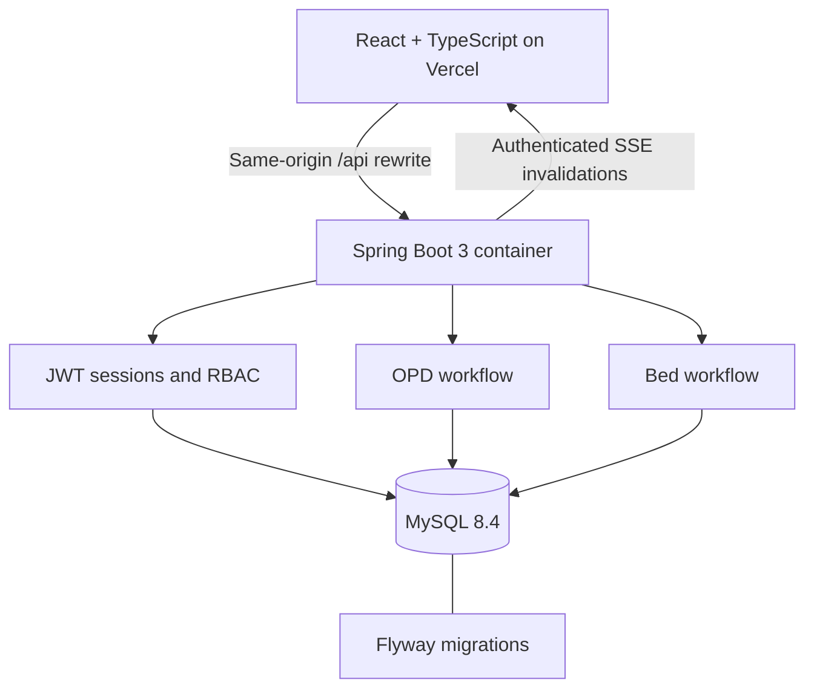
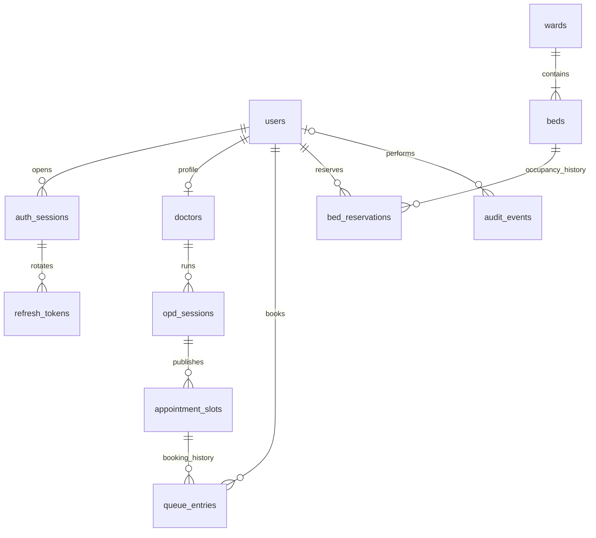

# e-AROGYATA

A hospital workspace for **OPD queueing and bed management**, rebuilt as a software engineering and application security portfolio project. Spring Boot 3 · React + TypeScript · MySQL · Flyway · Docker Compose.

Patients book a slot, check in, follow their queue position, and reserve a bed. Doctors call and complete their own queue. Ward staff admit, discharge and prepare beds. Admins publish OPD sessions, provision accounts and review the audit trail. Pharmacy, checkout, diagnostic tests, chat and medical records are outside this rebuild.

**Live demo:** not deployed. No public URL or recorded video is claimed. The frontend is configured for Vercel; the Java API and MySQL need a separate host. See [deployment](docs/DEPLOYMENT.md) and [two-minute recording workflow](docs/DEMO.md).

## Start locally

Requires Docker with Compose v2, Python 3 and internet access for container/dependency downloads. The optional native workflow needs Java 17+, Maven 3.9+, Node 24 and MySQL 8.4.

```bash
python3 scripts/dev-setup.py --demo
docker compose up --build --wait -d
```

Open **http://localhost:3000**. API health: http://localhost:8080/actuator/health. API contract: http://localhost:8080/openapi.json.

The setup script generates random local DB/JWT secrets and preserves any existing `.env`. The `--demo` flag explicitly enables synthetic users and publishes sessions for today and the following two days (when there is enough time remaining today). Without `--demo`, set bootstrap admin variables in `.env` before startup. MySQL is on a private Compose network and has no host port mapping. `docker compose down` preserves its named volume.

| Local demo role | Email | Password |
|---|---|---|
| Patient | patient@demo.earogyata.test | DemoOnly-ChangeMe42! |
| Doctor | doctor@demo.earogyata.test | DemoOnly-ChangeMe42! |
| Ward staff | ward@demo.earogyata.test | DemoOnly-ChangeMe42! |
| Admin | admin@demo.earogyata.test | DemoOnly-ChangeMe42! |

These are public synthetic credentials for an explicitly enabled local demo. Production has no default users; disable the demo profile and demo shortcuts.

## Architecture



The backend is a modular monolith using JDBC and explicit transaction boundaries. Read the [architecture and decisions](docs/ARCHITECTURE.md), [ER model and invariants](docs/SCHEMA.md), [OpenAPI contract](docs/openapi.json), and [threat model](docs/THREAT_MODEL.md). Frontend request/response types and the operation registry are generated from OpenAPI and checked for drift in CI.

## Database model



Flyway V1 creates identity/audit/rate limiting; V2 creates sessions, slots and queues; V3 creates wards, beds and reservations. Dates follow `HOSPITAL_TIMEZONE`; stored instants use UTC. No real patient details or clinical notes are included.

## Guarantees and deliberate choices

- **Bed safety:** a reservation locks the bed row. Generated unique active-bed and active-patient keys independently reject double occupancy and multiple active beds for one patient. Discharge atomically marks the bed CLEANING; ward staff must mark it ready.
- **Slot safety:** session/slot row locks and unique active-slot/patient-session keys enforce one active booking. Tickets increase under the session lock. Exactly one active consultation per session is enforced in MySQL.
- **Authorization:** public signup creates only PATIENT. Staff are provisioned by ADMIN. Doctors operate only their assigned session; patients operate only their own records. Patient identity is absent from bed availability responses.
- **Tokens:** 15-minute JWTs; issuer/audience/signature/time checks; session revocation checked on every request. Rotating, hashed refresh tokens live in an HttpOnly SameSite=Strict cookie. Replay commits session revocation. Access tokens stay in browser memory.
- **Live data:** authenticated fetch/SSE carries no token in the URL and no patient data in events. Events publish after transaction commit. Snapshots reconcile on reconnect, window focus and every 20 seconds. Fanout is local to one API process; polling supports convergence across replicas.
- **Security:** BCrypt, parameterized SQL, JSON input constraints, a 16 KiB body cap, origin checks for cookie refresh, shared MySQL rate limits and audit events. See [SECURITY.md](SECURITY.md) for exact limits and residual risks.

Appointments are scheduled slots; checked-in patients are called FIFO by ticket. Wait time is an estimate using the configured mean consultation duration. There is no hard-coded efficiency percentage. Reservations have no automatic expiry in this scope and end explicitly through cancellation or discharge.

## Verification

The build environment could execute frontend and dependency-free Java checks, but could not download Maven artifacts, run Docker/MySQL, launch a browser binary, or use the disabled deployment integrations. The backend is implemented with tests; it is **not yet verified end to end**.

| Check | Observed status |
|---|---|
| React production build + strict TypeScript | Passed |
| Frontend client/render/SSE tests | 13 passed |
| Java syntax parsing | Passed; does not resolve Spring dependencies |
| Standalone workflow smoke assertions | 9 passed; no database |
| OpenAPI references, operation IDs, copies, SQL-invariant names, XML | Structural checks passed; not full OpenAPI/SQL runtime validation |
| Spring Boot compilation, JUnit + real MySQL Testcontainers | Written; not run here |
| Docker Compose startup and active security probes | Configured in CI; not run here |
| CodeQL / OWASP dependency-check / npm audit | Configured; not run here |
| Browser layout, four-role end-to-end flow and video capture | Not run / not recorded here |
| Live deployment and API k6 benchmark | Not performed |

Run the actual integration suite on a Docker-capable machine:

```bash
cd backend
mvn -B verify
```

`BedIntegrationTest` starts 12 separate simultaneous service calls against real MySQL and asserts one success, eleven conflicts, and one persisted active reservation. Another race checks one patient reserving two beds. `QueueIntegrationTest` races two patients for one slot, verifies FIFO/consultation transitions and assigned-doctor/owner restrictions. Auth tests cover registration, role escalation, token tampering, refresh replay, origin checks and logout. Tests fail if Docker is unavailable; they do not silently skip or substitute H2.

```bash
cd frontend
npm ci
npm run build
npm test
```

From the repository root, `python3 scripts/check-project.py` performs dependency-free structural checks. The full [verification ledger](docs/VERIFICATION.md) states what was and was not executed.

## Security checks

After starting the local demo:

```bash
python3 scripts/security-probe.py
```

The script creates synthetic accounts and actively checks role escalation, patient access to staff routes, JWT tampering, cookie flags, CSRF origins, refresh replay, logout revocation, validation and brute-force limits. Its output is `results/security-probe.json`; no such result is claimed until it actually runs. CI starts the Compose stack and runs the same probes. The security workflow includes CodeQL for Java and TypeScript plus OWASP dependency-check with a CVSS 7 gate. An `NVD_API_KEY` GitHub secret improves database-update reliability; failures remain visible.

## API load test

Use only an isolated synthetic deployment with at least eight free beds. Install k6, then:

```bash
export ADMIN_EMAIL='admin@demo.earogyata.test'
export ADMIN_PASSWORD='DemoOnly-ChangeMe42!'
export BENCHMARK_ENV='Describe the actual machine, CPU/RAM and API/DB deployment'
k6 run load/hospital.js
python3 scripts/update-benchmark.py
```

The workload creates independent synthetic users and a new doctor session, then runs 8 virtual users × 25 iterations of OPD booking/cancellation and bed reservation/cancellation. It counts successful committed mutation requests. Its **target** is at least 500; it does not claim to have achieved that target before execution. Latency thresholds are acceptance criteria, not reported results. A manually triggered GitHub workflow stores the raw summary and updated README as artifacts.

<!-- BENCHMARK:START -->
**Measured API benchmark: not run.** Docker/MySQL and k6 were unavailable in the build environment. No latency, throughput, transaction-count or failure-rate numbers are invented. `scripts/update-benchmark.py` reads an actual k6 summary and includes failed thresholds as failures.
<!-- BENCHMARK:END -->

## Queue simulation

```bash
python3 scripts/simulate-queue.py --seed 42 --patients 500
```

<!-- SIMULATION:START -->
SIMULATED: 500 synthetic patients across 30 doctor-days, seed 42. Mean wait: 60.00 minutes under clustered arrivals versus 11.87 minutes under scheduled arrivals (80.22% simulated reduction). Both use the same FIFO policy and paired service durations. This tests arrival assumptions, not a new queue algorithm or a real clinical outcome. See [assumptions and raw simulation output](results/queue-simulation.json).
<!-- SIMULATION:END -->

## Native development and source layout

For a separately running local MySQL, set `DB_URL`, `DB_USER`, `DB_PASSWORD`, `JWT_SECRET` and `COOKIE_SECURE=false` before `mvn spring-boot:run` in `backend/`. Use `SPRING_PROFILES_ACTIVE=demo` only for synthetic data. `npm run dev` in `frontend/` proxies `/api` to localhost:8080. Native Vite origin is localhost:5173; Compose uses localhost:3000.

```text
backend/        Spring Boot modules, Flyway migrations, JUnit/Testcontainers
frontend/       Vite + React UI, generated contract types and frontend tests
docs/           Architecture, ER schema, OpenAPI, threat model, deployment
load/           k6 workload
scripts/        Contract generation, local setup, probes, simulation, evidence
qa/             Real browser walkthrough recorder
.github/        CI, CodeQL, dependency scanning, optional load-test workflow
```

The delivered archive includes `e-arogyata-history.bundle`, a local Git history with small module commits. To recover the repository history: `git clone e-arogyata-history.bundle e-arogyata-with-history`. Nothing was pushed to a remote repository.

The rebuild uses the supplied e-AROGYATA archive as its starting point. Original project metadata names Harsh Kumar and declares ISC licensing. See [provenance](NOTICE.md).
