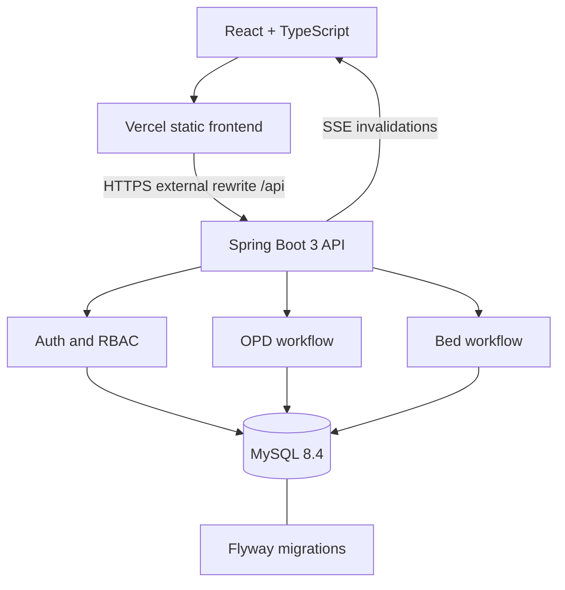

# Architecture and boundaries

e-AROGYATA is a single-hospital OPD and bed workflow. Patients book a slot, check in, see their ticket and an estimated wait, and reserve a bed. Doctors call and complete their own queue. Ward staff admit, discharge and prepare beds. Admins provision staff, publish doctor sessions, and review the audit trail. Pharmacy, payments, diagnostics, chat, clinical notes and medical records are outside the rebuild.

One deployable modular monolith, using JDBC parameter binding and service transaction boundaries. No repository/entity serialization leaks. The REST contract is `docs/openapi.json`, copied to `/openapi.json`; the frontend generates its types and operation registry from that file. The public health probe is `/actuator/health` and does not disclose database details. Java 17 is the baseline supported by Spring Boot 3.

## Identity and trust

15-minute HS256 JWTs carry issuer, audience, subject and session ID. Spring Security verifies signatures, issuer, audience and time, then loads role and session revocation from MySQL on every request. Passwords use BCrypt with cost 12 and a 72-byte UTF-8 cap. Public registration always creates PATIENT; only ADMIN can create staff. Access tokens live in browser memory. Refresh tokens are 256-bit random values, SHA-256 hashed in MySQL, rotated once, and held in a Secure HttpOnly SameSite=Strict cookie. A replay revokes its session and access tokens. A database row lock serializes refreshes; clients coordinate refresh across tabs using Web Locks and BroadcastChannel. Refresh requires an exact allowlisted Origin. The Vercel rewrite keeps cookie traffic on the frontend origin. Do not use cross-site cookies or tokens in query strings.

## OPD scheduling and queue

One doctor session per hospital calendar date. Admin publishes equally spaced, non-overlapping slots within that day. One patient per slot; one active appointment per patient/session. Slots are scheduling guidance; checked-in patients are called FIFO by ticket number, not by predicted completion time. Check-in is allowed only on the session day. A doctor may run only one consultation per session. Wait estimate = (WAITING patients ahead + active consultation) × configured mean duration, and is explicitly an estimate; no hard-coded efficiency claim. Patients see only their appointments; assigned doctors and admins see the identified queue. History is retained and bounded.

Session mutations acquire the session row first; booking then locks the slot. The session's increasing ticket counter is transactional. Generated nullable unique keys enforce active-slot occupancy, active patient/session uniqueness and one active consultation even if a future code path omits a check. Cancellation releases an active slot; completed appointments retain the slot's historical occupancy. NO_SHOW is reserved for a later explicit staff workflow; the current API never sets it.

## Beds and lock order

Beds have operational status AVAILABLE, CLEANING or OUT_OF_SERVICE. Visible RESERVED/OCCUPIED comes from the single active reservation, avoiding duplicated mutable occupancy. Reservation state is RESERVED → ADMITTED → DISCHARGED, or RESERVED → CANCELLED. Discharge and transition to CLEANING commit together. Ward staff must explicitly mark a clean bed AVAILABLE. Reservations have no automatic expiry in this scope. One active bed reservation per patient is enforced by MySQL.

Lock order is bed row → reservation row (transitions). Reserve locks the bed row before testing availability; two transactions cannot both reserve it. Generated `active_bed_id` and `active_patient_id` unique indexes are the second line of defense. Parallel tests use separate real MySQL connections and barriers, and assert exactly one success plus one persisted active reservation. A conflict returns 409 with no data loss.

## Events, audit and scale

Database transactions emit events only AFTER_COMMIT. SSE sends resource invalidations without identities; clients refetch authorized snapshots on events, reconnect, focus, and every 20 seconds. HTTP fetch streaming supports bearer headers. Stream lifetime is bounded by access expiry and session revocation is checked during heartbeat. Four streams per user, 256 total, heartbeat and disconnect cleanup. Fanout is local to one API process; multi-instance deployments converge through snapshot reconciliation. Add an outbox and shared broker for strict immediate fanout across replicas.

Successful mutations and staff reads of identified data create audit rows. Login failures, refresh replay, forbidden requests and throttling are recorded without credentials, tokens, diagnoses or payloads. The application exposes no audit edit/delete endpoint. Database operators remain trusted; this is not a tamper-evident external audit sink. Rate limits use MySQL atomic fixed windows across instances. The raw peer address is hashed; arbitrary forwarded IP headers are ignored. Production ingress should also enforce IP limits because a reverse proxy may aggregate peers.

## Deployment

Local: Docker Compose starts MySQL, Spring Boot, and nginx serving the Vite bundle. Production: Vercel serves `frontend/` and proxies `/api/:path*` to a separate long-running Java container, which reaches managed MySQL over TLS. Set the backend's allowed origin to the exact Vercel production URL. Deployment guide explains secrets, database grants, session bootstrapping and SSE buffering. Backend container memory and MySQL connection limits are explicit. No backend persistence is attempted inside Vercel functions.
