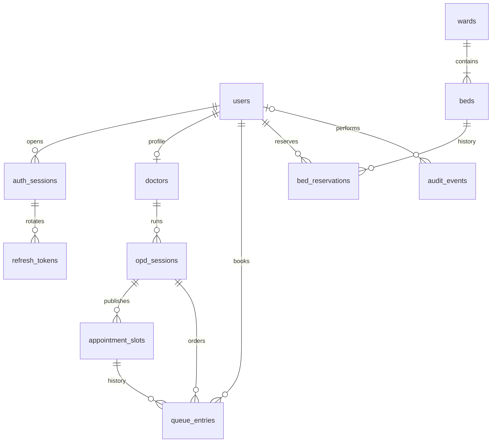

# Data model

Flyway owns the schema; migrations are append-only. MySQL 8.4/InnoDB is the concurrency test target. All persisted instants use UTC; session calendar dates use `HOSPITAL_TIMEZONE` (default Asia/Kolkata). Names and email are the only user details collected. No clinical data.

| Table | Invariant / indexes |
|---|---|
| users | Unique canonical lowercase email; CHECK of four supported roles; BCrypt hash |
| auth_sessions | UUID session ID; expiry and revocation checked on every JWT request |
| refresh_tokens | Unique SHA-256 hash; consumed tokens retained to detect replay |
| doctors | One profile per doctor user |
| opd_sessions | Unique doctor + hospital date; next_ticket incremented under row lock |
| appointment_slots | Unique session + start instant; composite FK target prevents queue/session mismatch |
| queue_entries | Unique active slot; unique active patient per session; one consulting entry per session; unique session ticket |
| wards / beds | Unique ward name and ward + bed label; operational status CHECK |
| bed_reservations | Unique generated active_bed_id and active_patient_id; inactive histories have NULL keys |
| audit_events | Time/id and actor references; no update/delete API |
| rate_limit_buckets | Hashed identity + minute primary key; expiry index for bounded retention |

Generated columns use `CASE ... ELSE NULL END`; MySQL permits multiple NULLs in unique indexes, so histories remain while active occupancy is unique. Status CHECK constraints reject invalid transitions' values; services enforce allowed state edges. Testcontainers tests must pass against MySQL, not H2.

Migration V1: identity, refresh rotation, audit, limiter. V2: doctor sessions, slots and queue. V3: wards, beds and reservations; reference wards/beds are seeded, users are not. Demo users and upcoming sessions are generated only with the explicit `demo` Spring profile. First production admin is optionally bootstrapped from environment; remove bootstrap password after first startup.
